# Cinema Studio by LQTAC 0.28.0 - Manual de usuario

Actualizado: 22 de noviembre de 2026.
Capturas reales con medios de demostración.

## Instalar y empezar

Todo el entorno de edición se ejecuta en tu equipo. El portable incluye los motores necesarios para editar, renderizar y generar subtítulos sin conexión.

### Descomprimir antes de abrir

Descarga el ZIP portable y extrae su contenido completo en una carpeta con permisos de escritura. No ejecutes el programa dentro del ZIP. Conserva juntas las carpetas y los motores incluidos: copiar únicamente el EXE o el BAT no es suficiente.

### Iniciar Cinema Studio by LQTAC

Abre el ejecutable Cinema Studio by LQTAC de la carpeta extraída. Si tu distribución incluye el BAT de inicio, también puedes usarlo con doble clic. No necesitas lanzar comandos ni instalar Node.js, Python o FFmpeg por separado.

### Un equipo adecuado

Como orientación práctica: Windows 10 u 11 de 64 bits, procesador de cuatro núcleos, 8 GB de RAM y SSD. Recomendados: 16 GB de RAM, pantalla de 1920 × 1080 y al menos 10 GB libres, además del espacio de tus medios y exportaciones. Son estimaciones de uso, no requisitos certificados por una batería de pruebas.

### En equipos modestos

Un Intel N150 puede servir para montajes sencillos en 720p o 1080p con pocas pistas. Reduce los efectos simultáneos y deja tiempo para el renderizado y la transcripción. La fluidez depende también del códec, la memoria y el almacenamiento.

### Antes de montar

Crea una carpeta para el trabajo, con subcarpetas para vídeo, audio, imágenes y exportaciones. Guarda allí el proyecto LQTS. Mantén una copia de seguridad de los medios: el proyecto no los contiene.

## Ayuda, manual y versión

Cinema Studio by LQTAC es el nuevo nombre de LQTAC Studio. Conserva los proyectos LQTS y la edición existente.

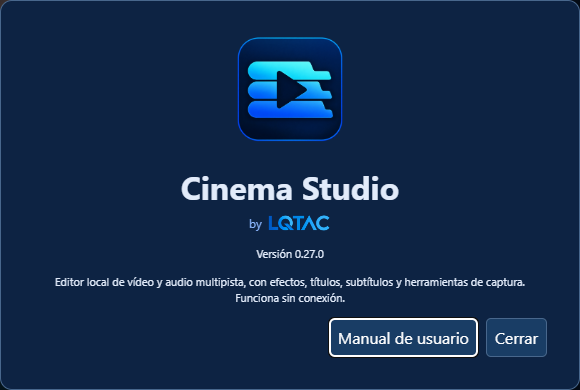

Ayuda > Acerca de… muestra la identidad y la versión real de la aplicación.

### Consultar la guía

Ayuda > Manual de usuario abre el PDF local más reciente. Funciona sin conexión; el portable debe conservarse completo para encontrar sus documentos.

### Comprobar la versión

Abre Ayuda > Acerca de… para ver el nombre, el símbolo de las pistas de edición, la descripción y la versión instalada. Desde esa ventana también puedes abrir el manual.

### Anclar en Windows

Abre Cinema Studio.exe y usa Anclar a la barra de tareas. La aplicación conserva su identidad interna y comunica el nuevo nombre, icono y lanzador. Si Windows sigue mostrando un icono almacenado en un acceso antiguo, desancla ese acceso y vuelve a anclar la aplicación abierta.

## Conocer el espacio de trabajo

La línea de tiempo ocupa aproximadamente la mitad de la ventana al iniciar. Puedes aumentar su espacio arrastrando la separación horizontal.

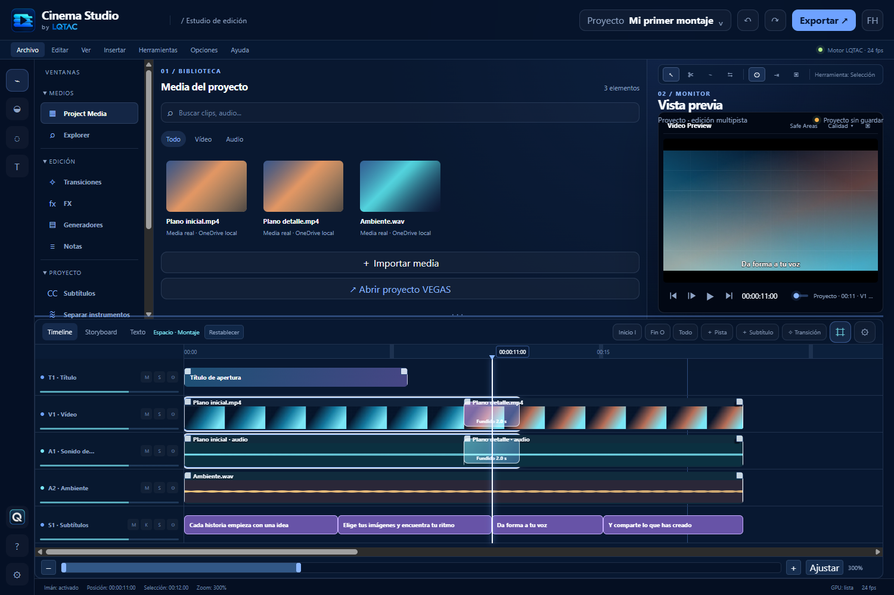

Un montaje de ejemplo: biblioteca arriba, monitor a la derecha y edición de pistas en la mitad inferior.

### 1. Menús, ventanas y espacios

Archivo reúne proyectos y exportaciones; Insertar añade medios, pistas y grabaciones. Herramientas contiene división, FX y subtítulos. Los cuatro iconos izquierdos cambian entre Montaje, Audio, Color y Texto, con distribuciones distintas. Ventanas abre paneles sin cambiar de espacio. Restablecer recupera la distribución inicial del espacio activo.

### 2. Biblioteca y monitor

Project Media muestra los medios del proyecto; Explorer permite localizar archivos. El monitor reproduce la composición y la mezcla de las pistas activas en la posición del cursor.

### 3. Línea de tiempo

Las cabeceras contienen los controles de pista. La regla superior permanece visible al desplazarte por las pistas. La línea vertical y su flecha indican la posición de reproducción.

## Elegir un espacio de trabajo

Los cuatro iconos izquierdos reorganizan las herramientas del mismo proyecto. Ventanas abre paneles individuales sin cambiar de espacio. Restablecer recupera el reparto inicial; cada modo recuerda su división vertical durante la sesión.

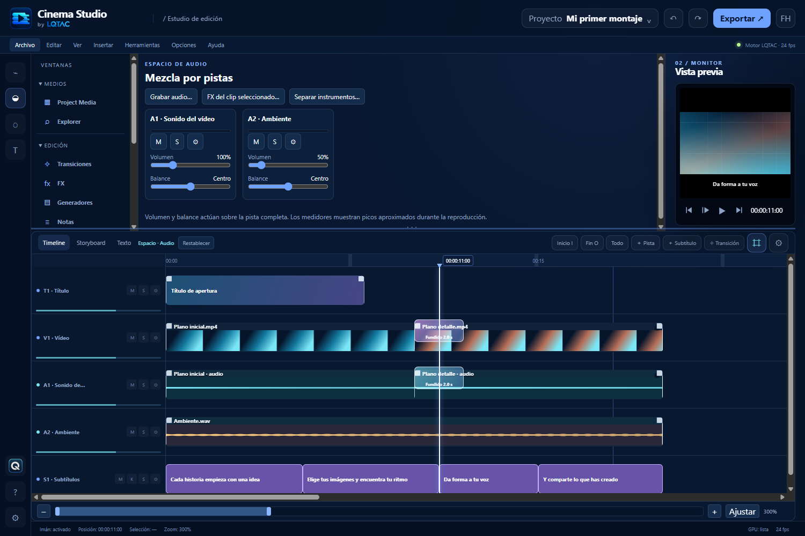

Audio: mezclador por pistas, monitor reducido y filas más altas. Los controles actúan sobre el proyecto.

### Montaje

Es el espacio inicial: biblioteca amplia, monitor y aproximadamente mitad inferior para montar pistas. Volver aquí facilita continuar con recortes y organización.

### Audio

Da prioridad al timeline y a las ondas. El mezclador controla volumen, balance, Mute y Solo por pista. Sus cambios admiten deshacer. Los medidores responden a la reproducción con picos aproximados, no una medición profesional de loudness.

### Color

Amplía el monitor y ofrece un histograma RGB aproximado de la vista previa. Selecciona un vídeo y abre brillo, temperatura, saturación, LUT, croma o viñeta en sus editores existentes.

### Texto

Amplía la vista previa y reúne plantillas de generadores, edición del título o subtítulo seleccionado y acceso a subtítulos/karaoke. Cambiar de espacio no mueve clips ni añade pasos al historial. Al reiniciar se vuelve a Montaje.

## Crear un proyecto e importar medios

Añadir un archivo a la biblioteca y colocarlo en la línea de tiempo son dos acciones distintas.

La biblioteca presenta los medios en mosaico. Importar no modifica el archivo original.

### 1. Empezar y guardar

Elige Archivo > Nuevo (Ctrl + N). Si hay cambios pendientes, decide si guardarlos antes de continuar. Usa Guardar como… para dar nombre y ubicación al proyecto LQTS.

### 2. Alimentar la biblioteca

En Insertar, elige Insertar vídeo al proyecto, Insertar audio al proyecto o Insertar imagen al proyecto. Estas entradas incorporan medios a la biblioteca; todavía no crean un montaje.

### 3. Colocar un medio

Arrastra el elemento desde Project Media o Explorer hasta una pista compatible. El punto donde lo sueltas fija su inicio. La duración procede del archivo, no de un límite fijo de 15 segundos.

### 4. Comprobar el resultado

Al insertar vídeo con audio, se crean eventos de vídeo y sonido separados y agrupados. Revisa ambos en el timeline y pulsa reproducir en el monitor. Si falta un medio al abrir el proyecto, restaura el archivo en la ruta indicada.

## Pistas, posición y selección

Organiza cada tipo de contenido en sus pistas y utiliza el cursor para comprobar cualquier momento del montaje.

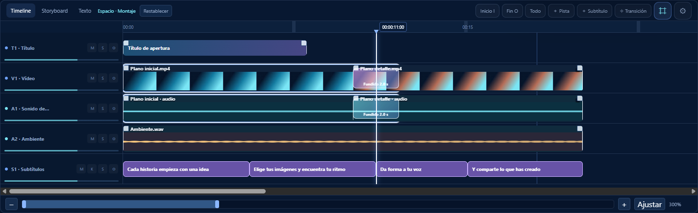

Vídeo, sonido asociado, ambiente y subtítulos comparten la misma escala de tiempo.

### Crear, ordenar o eliminar pistas

Usa Insertar > Insertar pista de vídeo, audio o subtítulos. Arrastra el nombre de una pista hacia arriba o abajo: la marca indica dónde quedará al soltar. En los bordes la lista se desplaza automáticamente. Escape cancela; Ctrl + Z deshace. Sobre la pista, botón derecho > Eliminar pista retira esa fila y sus eventos.

### Mover y seleccionar

Arrastra un clip para cambiarlo de posición o de pista compatible. Arrastra sobre una zona vacía para seleccionar varios eventos con un rectángulo; Ctrl permite ampliar la selección. Las agrupaciones mantienen unidos los eventos vinculados.

### Situar la reproducción

Arrastra la flecha de la regla o pulsa en ella para cambiar de posición. Las flechas izquierda y derecha avanzan o retroceden un fotograma; con Mayús el salto es de un segundo. Los campos de texto conservan su funcionamiento habitual cuando estás escribiendo.

### Zoom y escucha

Ajusta el zoom y desplázate con la barra del timeline para trabajar con precisión. M silencia una pista y S la pone en solo. La S de la cabecera es Solo; la tecla S, cuando editas clips, sirve para dividir.

## Recortar, dividir y agrupar

La edición cambia el montaje, sin sobrescribir el medio original. Guarda con frecuencia y usa Deshacer para revisar los cambios.

Los eventos de vídeo y audio importados juntos conservan su sincronía mediante la agrupación.

### Recortar los extremos

Arrastra el borde izquierdo o derecho hacia dentro para quitar contenido del principio o del final. La zona superior de la esquina tiene otra función: crear un fade. Acerca el zoom si resulta difícil distinguir el control.

### Dividir en la posición actual

Selecciona el evento, coloca el cursor donde quieras cortar y pulsa S. Revisa los elementos agrupados antes y después de la división para mantener el montaje deseado.

### Copiar, pegar y borrar

Ctrl + C copia la selección y Ctrl + V la pega tomando como referencia la posición de reproducción. Supr elimina los eventos seleccionados; también puedes usar botón derecho > Eliminar. Ctrl + Z deshace y Ctrl + Y rehace.

### Agrupar y desagrupar

Selecciona varios eventos y usa botón derecho > Agrupar. Para editar por separado el vídeo y su sonido, usa Desagrupar sobre el conjunto. Después pueden perder la sincronía si mueves solo uno. Para nombre, silencio, nivel o velocidad usa botón derecho > Propiedades del evento… El inspector lateral permanente se ha retirado.

## Velocidad, repetición e inversión

La misma zona del borde permite acciones diferentes según las teclas que mantengas pulsadas.

### Cambiar la velocidad

Mantén Ctrl mientras arrastras un extremo. Si alargas el evento, se reproduce más despacio; si lo acortas, más deprisa. El cambio afecta al conjunto agrupado, incluido el audio del vídeo mientras siga vinculado.

### Actuar sobre un solo evento

Mantén Ctrl + Alt mientras arrastras el extremo para modificar únicamente ese clip, aunque esté agrupado. Es útil para ajustes deliberados, pero puede romper su sincronización con el resto.

### Repetir el contenido

Sin Ctrl, prolonga el evento más allá de la duración disponible de la fuente para repetirlo. Las marcas de unión señalan el final de cada repetición y el comienzo de la siguiente. No se crea un nuevo archivo de medios.

### Reproducir de final a inicio

En el menú contextual del clip elige invertir el clip o invertir el grupo. La preparación de medios invertidos puede tardar; espera a que finalice antes de valorar la reproducción.

### Ejemplo práctico

Para conservar una entrevista sincronizada, deja agrupados vídeo y audio. Para una cámara lenta sin su sonido, desagrupa o silencia el audio primero. Comprueba la voz y los transitorios después de cualquier cambio de velocidad; no presupongas una conservación automática del tono.

## Fundidos y transiciones

La duración de una transición la determina el solapamiento entre dos eventos de la misma pista.

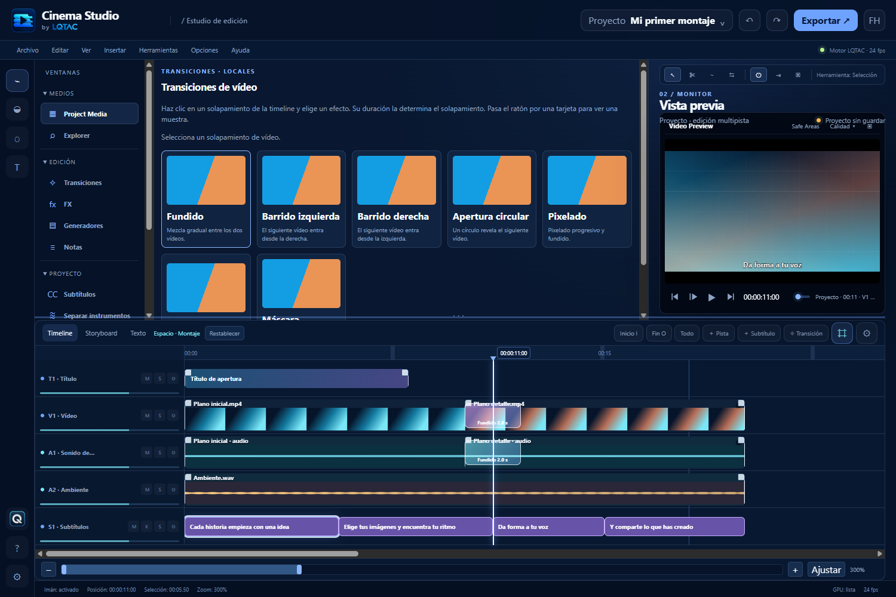

El panel Transiciones permite elegir el tratamiento del solapamiento seleccionado.

### Un fade en un solo clip

Arrastra la esquina superior izquierda hacia dentro para un fade-in, o la superior derecha para un fade-out. En vídeo cambia la visibilidad; en audio, el nivel. Cada extremo se ajusta de forma independiente.

### Una transición entre dos clips

Solapa dos eventos de una misma pista. Por defecto se crea un fundido entre ambos, tanto en vídeo como en audio. Un solapamiento de dos segundos produce una transición de dos segundos.

### Elegir un efecto diferente

Selecciona el solapamiento y abre Transiciones. Aplica la tarjeta que quieras a esa unión. Las distintas uniones del proyecto pueden tener efectos y ajustes diferentes; revisa cuál está seleccionada antes de cambiarla.

### No confundir las acciones

Mover un clip modifica el solapamiento; recortar su borde modifica el contenido visible; arrastrar su esquina ajusta un fade. Usa zoom y reproduce antes y después de la unión para verificar el resultado.

## Una máscara de luminancia propia

Una imagen en blanco y negro puede definir por dónde aparece el siguiente vídeo. La imagen actúa como máscara, no como una capa visible.

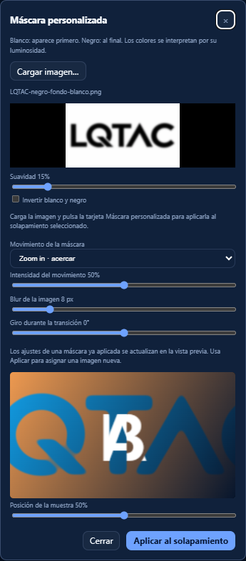

Detalle del mismo panel en dos partes: carga y suavidad a la izquierda; movimiento, blur y muestra a la derecha.

### 1. Seleccionar la unión

Crea un solapamiento de vídeo y selecciónalo. En Transiciones, elige Máscara personalizada. Sus ajustes se abren en una ventana de configuración, sin ocupar permanentemente la biblioteca.

### 2. Cargar la forma

Pulsa Cargar imagen… El selector parte de la carpeta Shapes del proyecto. Puedes utilizar el LQTAC negro sobre blanco incluido como ejemplo, o elegir otra imagen. Los colores se interpretan por su luminosidad.

### 3. Elegir el movimiento

Selecciona el tratamiento de la máscara: por ejemplo, zoom de entrada o salida, desplazamiento o temblor. Ajusta la suavidad y el desenfoque para crear bordes más o menos graduales; invierte blanco y negro para cambiar el sentido.

### 4. Evaluar sobre los dos vídeos

El blanco aparece primero y el negro al final, salvo inversión. Recorre todo el solapamiento con el cursor. Si ves un resultado inesperado, comprueba el efecto asignado, la inversión y los ajustes de la máscara en esa unión.

## Envolventes de volumen y opacidad

Las envolventes modifican un valor a lo largo de la pista. Permanecen ocultas hasta que las activas desde su menú contextual.

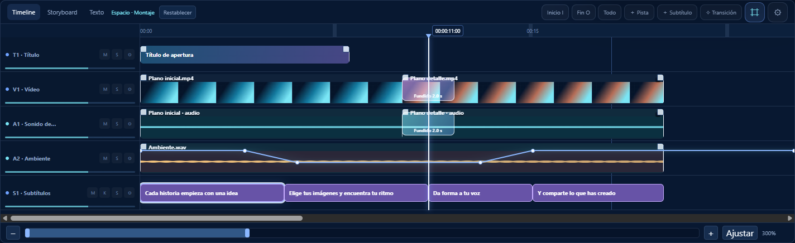

La línea y sus puntos permiten cambios graduales. La envolvente pertenece a la pista.

### Mostrar la envolvente

Pulsa con el botón derecho sobre la pista y activa su envolvente de volumen o de transparencia/opacidad, según el tipo de pista. No es necesario mostrar todas las líneas mientras montas.

### Crear y mover puntos

Pulsa con el botón derecho en la línea para añadir un punto. Arrástralo para cambiar su posición temporal y su valor. Utiliza la opción de eliminar del editor o su menú contextual para retirar los puntos que sobren.

### Subir o bajar un tramo

Arrastra la línea entre dos puntos para desplazar ese segmento. En audio cambia el nivel; en vídeo cambia cuánto se ve de la pista. Dos puntos separados producen una rampa, no un salto instantáneo.

### Ejemplo: música bajo una voz

Crea puntos antes y después de la frase. Baja el tramo que coincide con la voz y conserva rampas al entrar y salir. Reproduce con todas las pistas activas para decidir el nivel por el resultado de la mezcla.

## FX de vídeo y animación

Selecciona el clip y abre FX o Herramientas > Efectos de vídeo. El editor individual muestra el efecto sobre ese clip y su evolución temporal.

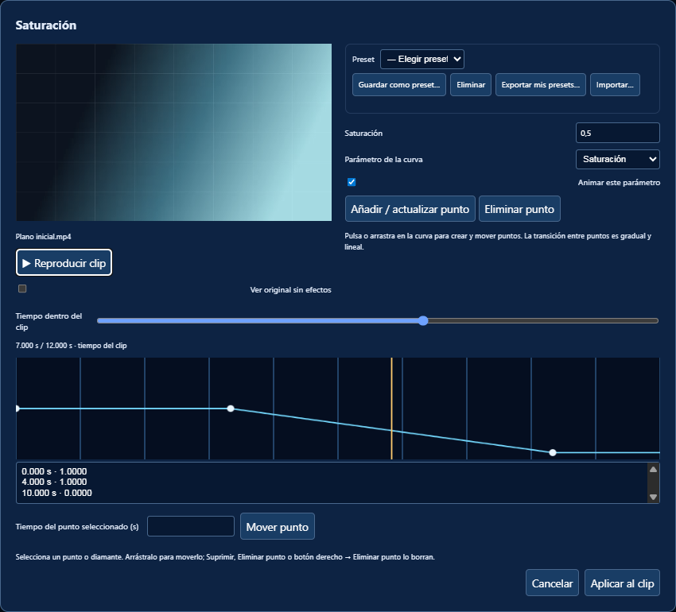

Ejemplo: mantener el color al principio y reducir la saturación hasta blanco y negro.

### Ajustar y comparar

Elige el efecto y cambia sus parámetros. Reproduce el clip dentro del editor o desplaza su control de tiempo. Ver original sin efectos permite comparar con la fuente. Aplicar al clip conserva los cambios; Cancelar descarta la edición de esa sesión.

### Crear una curva

Selecciona el parámetro y activa Animar este parámetro. Añade un punto al principio con saturación 1 y otro más tarde con 0. La interpolación entre ambos hace que el color desaparezca gradualmente.

### Corregir puntos

Pulsa o arrastra en la curva para crear o mover puntos. Selecciona el punto que quieras retirar y usa Eliminar punto. Los tiempos son relativos al inicio del clip, no al inicio de todo el proyecto. Las LUT se cargan como ajustes fijos en esta versión.

## FX de audio con escucha

El editor permite ajustar el sonido y escuchar el resultado. Para el ecualizador muestra graves, medios y agudos a la vez, en colores distintos.

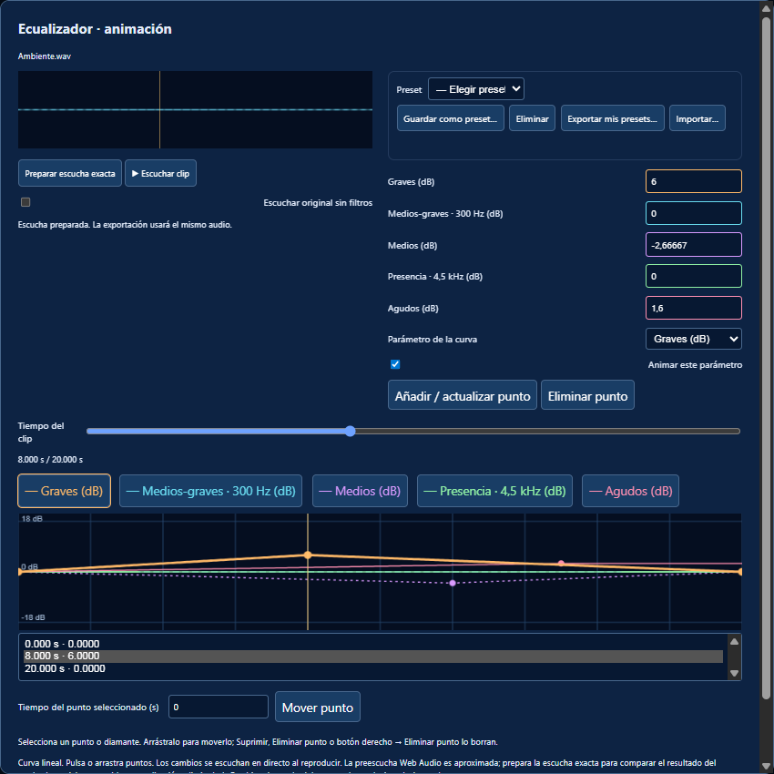

Las tres curvas del ecualizador comparten el tiempo; selecciona el parámetro que quieras editar.

### Trabajar con el sonido

Selecciona un evento de audio y abre el efecto en FX o en Herramientas > Efectos de audio. Ajusta el ecualizador, compresor, limitador, reducción de ruido, normalización, eco o reverberación y escucha el fragmento.

### Animar un parámetro

Activa la animación y añade puntos. Por ejemplo, aumenta los agudos solo durante una parte del clip. Selecciona una curva antes de mover o borrar sus puntos; el resto permanece visible como referencia.

### Escucha directa y exacta

La escucha en tiempo real facilita el ajuste, pero ciertos procesamientos son aproximaciones. Usa Preparar escucha exacta para comprobar el resultado procesado por el motor de audio. Tras cambiar parámetros, prepara de nuevo esa escucha. Compara también con el original sin filtros.

## Presets de efectos

Cada editor de efectos tiene arriba una barra Preset con ajustes listos para usar y los tuyos propios. Hay 125 de fábrica: 61 de vídeo y 64 de audio.

### Probar un preset

Abre un efecto desde FX o Herramientas > Efectos de vídeo o de audio y elige un preset en la lista. Se aplica al borrador al momento, así que lo ves y lo escuchas en la vista previa. Aplicar al clip lo confirma; Cancelar lo descarta. Cada preset solo cambia los parámetros de su efecto: un preset de saturación no toca el brillo.

### Guardar los tuyos

Ajusta el efecto y pulsa Guardar como preset…. Ponle un nombre y marca si quieres guardar también la animación. Las curvas se guardan en proporción a la duración del clip, de modo que se adaptan a clips más largos o más cortos.

### Compartir y borrar

Exportar mis presets… crea un archivo .lqfx con todos tus presets de vídeo o de audio; Importar… los añade y renombra los nombres repetidos. Eliminar borra un preset propio. Los presets de los paquetes instalados aparecen en el grupo Paquetes.

### Ejemplos

Vídeo: blanco y negro, colores vivos, «Color → blanco y negro» animado, nieve, lluvia, confeti, destello que cruza, rayos de sol, onda expansiva o estela fantasma. Audio: voz de radio, sala de conciertos, ardilla, corrección natural de afinación o efecto robótico.

## Efectos especiales de vídeo

El catálogo FX > Vídeo incluye efectos de luz, partículas y deformación, además de estabilizar, seguir objetos y dibujar máscaras animadas.

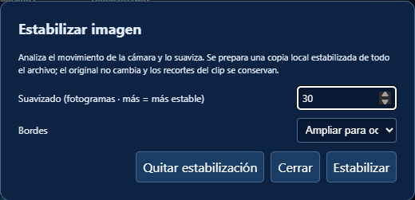

Estabilizar imagen prepara una copia local estabilizada; el archivo original no cambia.

### Luz, partículas y deformación

Partículas (nieve, lluvia, chispas, polvo, confeti, burbujas o bokeh), destello de lente, rayos de luz, fugas de luz, parpadeo, ondas de agua, remolino, ojo de pez, onda de calor, espejo o caleidoscopio y estela. Se animan con curvas como el resto de FX. En el destello, haz clic sobre la vista previa para situar su centro.

### Estabilizar imagen

Suaviza el temblor de la cámara. Elige el suavizado (1–100 fotogramas) y qué hacer con los bordes: ampliar para ocultarlos o mantener el encuadre con bordes negros. Se procesa el archivo completo, una vez y media su duración aproximadamente, y la copia se reutiliza. Quitar estabilización vuelve al original.

### Antes de estabilizar

No se puede estabilizar un clip invertido: restaura primero su dirección. Los recortes, divisiones y cambios de velocidad del clip se conservan.

## Seguimiento y máscaras dibujadas

El seguimiento de movimiento registra el recorrido de un objeto y lo aplica a un efecto, a una máscara o a un título. La rotoscopia recorta o limita los efectos a una forma que tú dibujas.

### 1. Tramo y zona

Abre Herramientas > Efectos de vídeo > Seguimiento de movimiento. Marca el inicio y el fin con Marcar inicio aquí y Marcar fin aquí, o deja todo el clip. En el instante de inicio, arrastra un rectángulo sobre algo con detalle y contraste.

### 2. Analizar y aplicar

Analizar el tramo sigue la zona 15 veces por segundo y guarda el resultado en el clip. Después elige el destino y pulsa Aplicar: la posición del destello, de los rayos, de las ondas o del remolino; la máscara dibujada del clip; o un título de otra pista que coincida en el tiempo. Cada destino tiene su botón Quitar.

### 3. Máscara dibujada

En Máscara dibujada (rotoscopia) haz clic alrededor de la zona y pulsa el primer punto para cerrarla (de 3 a 64 puntos). En otro instante, arrastra los puntos para crear un fotograma clave; Mayús + arrastrar mueve toda la máscara. Úsala para recortar el clip o para aplicar efectos solo dentro, por ejemplo para desenfocar una matrícula.

### Límites

El seguimiento sigue la posición, no la rotación ni la escala. Si el objeto queda tapado o cambia mucho, puede perderse.

## Croma por zonas

En FX > Croma / fondo transparente, «Zona donde actúa el croma» decide dónde se elimina el color de fondo.

### Todo el fotograma

El croma clásico: elimina el color elegido en toda la imagen.

### IA rápida · proteger personas

Incluida y en directo. Detecta a las personas en cada fotograma y solo quita el color fuera de ellas. Sirve cuando el color del fondo también aparece en la ropa. Funciona sin conexión y usa la gráfica si está disponible.

### IA precisa · cualquier objeto

Módulo opcional que se descarga desde la propia ventana. Pulsa Marcar y analizar…, haz clic izquierdo sobre lo que se conserva y clic derecho sobre el fondo; puedes marcar en varios instantes y hasta 4 objetos. Necesita un análisis previo y consume mucha CPU: en un portátil, unos 5 minutos de vídeo a 12 fps tardan alrededor de una hora.

## Pack de audio y autotune

FX > Audio incluye filtros, efectos de voz y espacio, y un autotune con pista guía. Todos tienen escucha, presets y curvas.

### Efectos del pack

Filtro paso alto y paso bajo, puerta de ruido, de-esser, cambio de tono (−12 a +12 semitonos), chorus, trémolo, lo-fi, ensanche estéreo, reverb de sala por convolución y panorámica. En los efectos con varios valores, cada parámetro tiene su curva de color.

### Autotune

Lleva cada nota a la más cercana de la escala. Elige tonalidad y escala (si no la conoces, usa Cromática), la intensidad de la corrección y la velocidad de ajuste: 0 da el efecto robótico y 1 un deslizamiento natural. Para una sola voz o instrumento melódico; con acordes o música de fondo la detección se confunde.

### Pista guía

En el apartado Pista guía elige otra pista con la melodía (un piano o una voz de referencia, una nota a la vez). La voz se lleva a la nota de la guía: Seguir notas conserva su vibrato y Copiar entonación copia también los deslizamientos. La guía puede estar silenciada para que no se oiga al exportar.

### Escucha exacta

La escucha en directo es aproximada y puede sonar algo granulada. Para juzgar el resultado final, usa Preparar escucha exacta. Opciones > Caché de audio procesado… muestra lo que ocupan estas copias y permite vaciarlas.

## Separar una canción en instrumentos

Demucs estima cuatro fuentes: Voz, Batería, Bajo y Otros instrumentos. El motor y el modelo están incluidos para trabajar sin Internet ni instalar Python.

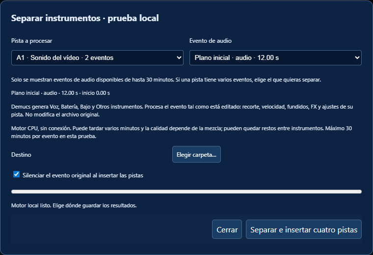

El diálogo se abre sin selección previa. Puedes elegir la pista y uno de sus eventos de audio.

### 1. Elegir el audio

Abre Ventanas > Separar instrumentos, debajo de Subtítulos. También está en Herramientas y en el espacio Audio. Elige Pista a procesar y Evento de audio; el clip válido que tuvieras seleccionado se propone automáticamente.

### 2. Comprobar qué se separa

Se procesa ese evento con su recorte, velocidad, inversión, fundidos, FX y ajustes de pista. Si quieres trabajar con la grabación sin tratar, separa antes de añadir efectos. No se procesa toda la pista si contiene varios eventos.

### 3. Preparar el destino

Solo se muestran eventos con archivo disponible y duración de hasta 30 minutos. Sin ninguno válido aparece «Aún no hay pistas a procesar en este proyecto». Elige una carpeta y pulsa Separar e insertar cuatro pistas. El proceso usa CPU y puede tardar varios minutos.

## Escuchar y conservar los resultados

Las cuatro salidas se guardan en una carpeta nueva y se incorporan al proyecto. El archivo original permanece intacto.

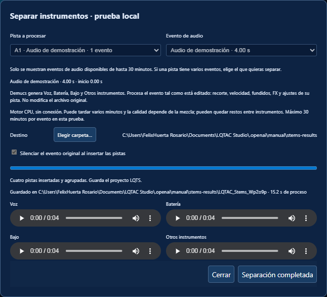

Detalle de resultados sobre audio sintético de demostración. Las escuchas no arrancan automáticamente.

### Pistas sincronizadas

Se crean cuatro pistas de audio con eventos agrupados, en el inicio y con la duración del origen. Deja marcada Silenciar el evento original para evitar duplicar la canción. Después puedes usar Mute y Solo para escuchar o mezclar cada instrumento.

### Comparar y guardar

Escucha cada WAV en el diálogo o cierra la ventana para reproducir el proyecto. Se pausa la escucha anterior al iniciar otra. Guarda el LQTS y conserva la carpeta de resultados: son WAV PCM24 estéreo a 44,1 kHz. Deshacer retira la inserción y restaura el silencio anterior, pero conserva los WAV guardados.

### Límites de la separación

No se recuperan las grabaciones originales. Puede haber restos entre instrumentos o sonidos artificiales; Otros agrupa guitarras, piano y lo que no sea voz, batería o bajo. Cancelar detiene la operación sin insertar pistas. Para un audio largo, divide en eventos de hasta 30 minutos y procesa cada uno; esta versión crea cuatro pistas nuevas por operación.

## PAN: encuadrar y mover la cámara

El editor visual de PAN permite recortar y desplazar el encuadre, ajustar proporciones y animar el movimiento durante el clip.

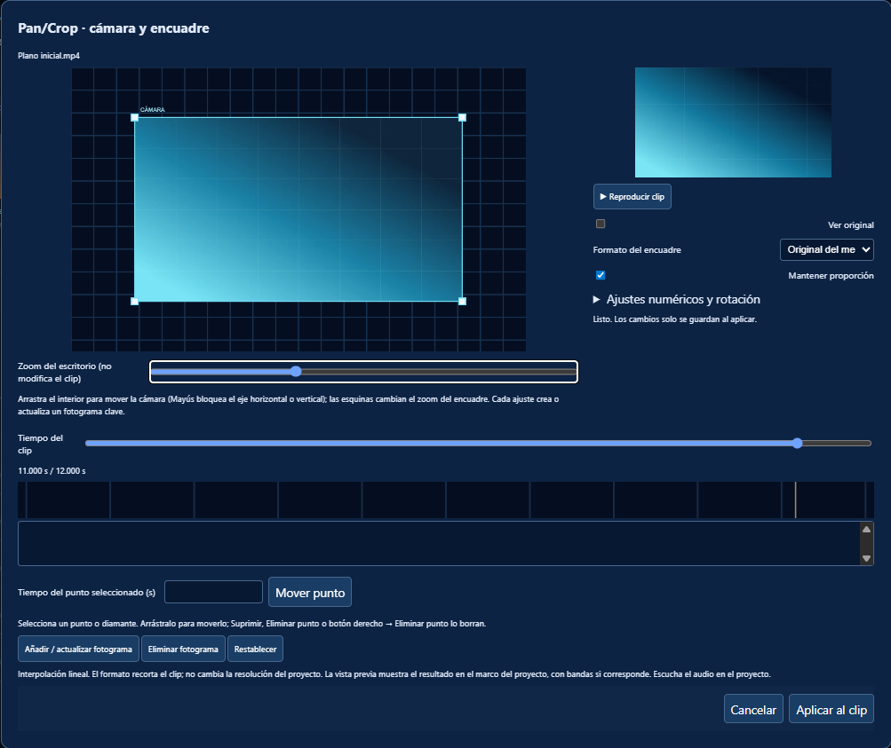

El escritorio de encuadre y la vista resultante permiten comprobar el movimiento de cámara.

### Encuadrar

Selecciona el clip y abre PAN desde el área de efectos. Arrastra el marco o sus esquinas para desplazar y redimensionar el encuadre. Activa mantener proporción cuando quieras conservar su forma.

### Elegir formato

Utiliza una relación como 4:3, 16:9 o 15:9 como punto de partida. Cambiar el encuadre del clip no sustituye la elección de resolución y formato del archivo final al renderizar.

### Animar el recorrido

Coloca el tiempo al inicio y añade una posición. Avanza, cambia el encuadre y añade otra. Puedes mover el momento de los puntos o eliminarlos. Mantén Mayús al arrastrar la cámara para restringir el movimiento a un eje horizontal o vertical. Reproduce el recorrido y aplica cuando esté listo.

## Trayectoria: mover un objeto por una ruta

Un vídeo, una imagen con transparencia o un GIF animado pueden recorrer una ruta dibujada en pantalla. La zona de peso, por ejemplo la cabeza de un pájaro, va sobre la ruta y el cuerpo la sigue al girar.

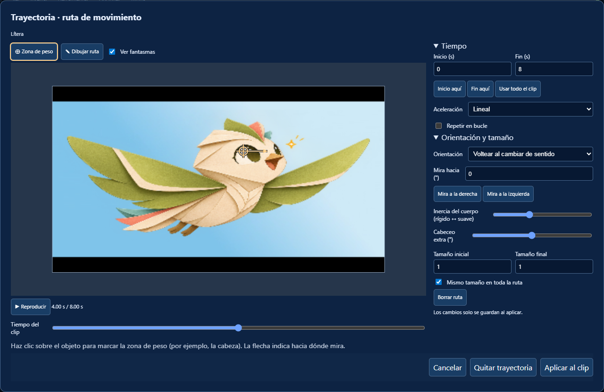

Zona de peso marcada en la cabeza de Lítera; la flecha indica hacia dónde mira.

### Abrir el editor

Coloca el objeto en una pista por encima del fondo, selecciónalo y abre Herramientas > Efectos de vídeo > Trayectoria · ruta de movimiento… o la casilla Trayectoria · ruta de movimiento del panel FX (sección Vídeo), junto a Pan/Crop. El lienzo muestra el fotograma real del proyecto.

### 1. Marcar la zona de peso

Pulsa Zona de peso: el objeto aparece en reposo. Haz clic sobre el punto que manda, normalmente la cabeza. La flecha indica hacia dónde mira; cámbiala con Mira a la derecha, Mira a la izquierda o en grados.

### 2. Dibujar la ruta

Pulsa Dibujar ruta. Cada clic añade un nodo al final; si arrastras al crearlo, la línea se curva. Arrastra nodos y tiradores para corregirla. Mayús + clic pone un nodo encima de otro, útil para cerrar un rizo. Doble clic borra un nodo y Ctrl + clic sobre la línea inserta uno. La zona gris queda fuera de cuadro, para entrar y salir de plano.

## Trayectoria: giro, tiempo y GIF animados

Ajusta cuándo se recorre la ruta y cómo gira el objeto. Los fantasmas muestran seis poses a lo largo del camino.

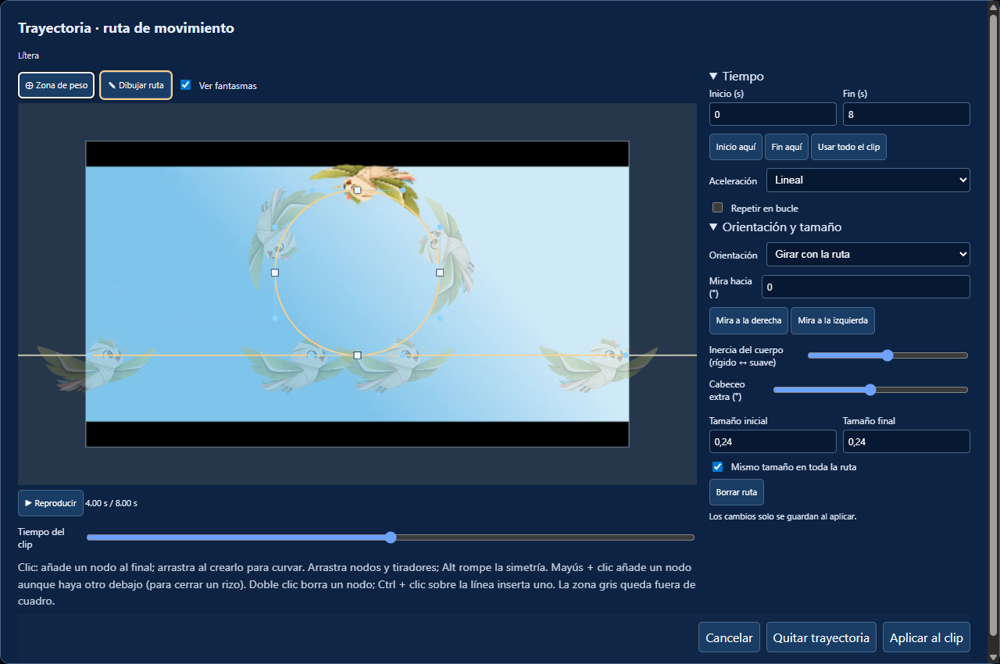

Un looping dibujado con el ratón: Lítera pasa boca abajo en lo alto del rizo, como un pájaro real.

### Tiempo y orientación

Elige inicio y fin (o Usar todo el clip), la aceleración y si se repite en bucle. La orientación puede girar con la ruta (loopings, flechas, naves), voltear al cambiar de sentido para que un animal de perfil no vaya boca abajo, o no girar. La inercia retrasa el cuerpo respecto a la cabeza en las curvas; también hay cabeceo extra y tamaño inicial y final.

### Comprobar y aplicar

Ver fantasmas, Reproducir y la barra de tiempo enseñan el movimiento sin salir del editor. Aplicar al clip se puede deshacer; Quitar trayectoria la elimina. Al dividir, recortar, repetir o estirar el clip se conserva la pose en cada instante.

### GIF animados con transparencia

Importa el GIF como un vídeo. La primera vez se convierte en tu equipo a un vídeo con transparencia y se guarda en caché; el proyecto sigue apuntando al GIF original. Si dura menos que el tramo, usa Repetir. Invertir o estabilizar un GIF pierde la transparencia.

## Generadores: títulos y gráficos

Generadores crea contenido para tu montaje: texto, títulos, rótulos, créditos y carteles. No es otra vista de la biblioteca.

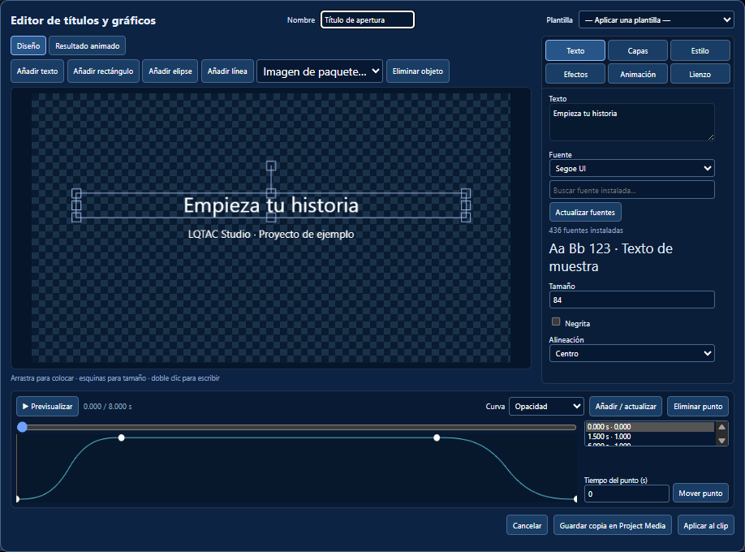

El editor compacto mantiene el diseño y los botones de salida visibles, con propiedades organizadas en pestañas.

### Elegir y diseñar

Abre Generadores y parte de una plantilla. Añade texto o formas. Arrastra para posicionar, usa los controles de tamaño y haz doble clic para editar el texto. Selecciona el objeto antes de cambiar su aspecto.

### Usar las pestañas

Texto reúne el contenido y la tipografía. Estilo agrupa el aspecto; Animación controla la evolución; Lienzo permite ajustar el fondo y la duración. Alterna Diseño y Resultado animado sin perder el área de trabajo.

### Decidir el destino

Guardar en Project Media añade un medio generado a la biblioteca. Añadir a timeline lo incorpora al montaje. Con fondo transparente puedes colocarlo en una pista de vídeo sobre las imágenes. No necesitas renderizar un vídeo externo para reutilizar el diseño.

## Animar títulos y elegir fuentes

Una animación puede entrar suavemente, desplazarse, ampliarse o cambiar su opacidad. Los puntos permiten definir el recorrido a medida.

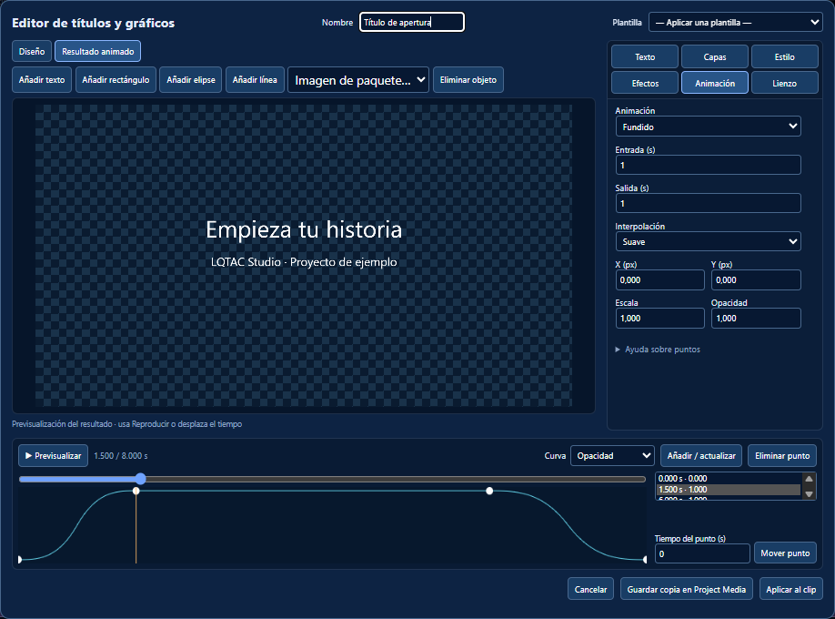

La línea de animación del generador utiliza tiempo relativo a la duración del título.

### Del preset a los puntos

En Animación, elige una animación predefinida o crea puntos personalizados de posición, escala u opacidad. Los puntos personalizados toman el control del movimiento mientras estén presentes. Comprueba el resultado en Resultado animado.

### Editar la curva

Pulsa en la curva o usa Añadir punto. Arrastra un punto horizontalmente para cambiar su instante y verticalmente para cambiar el valor de la propiedad seleccionada. Selecciónalo para eliminarlo con Supr o su opción contextual; también puedes ajustar el tiempo numéricamente.

### Fuentes del ordenador

Generadores y subtítulos permiten usar las fuentes instaladas en Windows. Busca la familia, comprueba la muestra y actualiza el catálogo si acabas de instalar una. Al compartir el proyecto, instala también las fuentes necesarias en el otro equipo: el LQTS no las incorpora.

## Plantillas y efectos de títulos

El editor de títulos y gráficos trae plantillas, efectos de entrada y salida por letra, palabra o línea, degradados, brillo y texto en perspectiva.

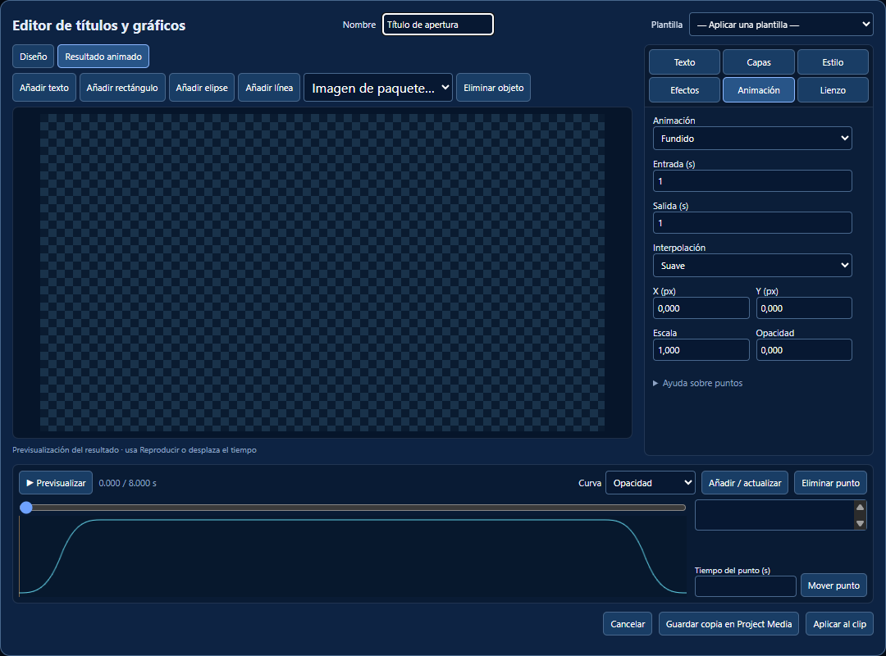

Pestaña Animación del editor de títulos, con la curva de opacidad de la composición.

### Plantillas

El selector Plantilla, arriba a la derecha, sustituye el diseño por uno listo para editar: títulos (cine, neón, degradado dorado, máquina de escribir, crawl…), rótulos y créditos. Solo muestra las del mismo tipo que el gráfico abierto. Si te equivocas, Cancelar descarta el cambio.

### Entrada, salida y movimiento

En Efectos, elige la entrada (fundido, subir, caer, escalar, desenfoque, girar, barrido o máquina de escribir), cómo se aplica (letra, palabra, línea u objeto) y su suavizado; la salida funciona igual. El movimiento continuo añade ola, latido o temblor. En Estilo hay degradado lineal y brillo.

### Texto en perspectiva

Animación > Texto en perspectiva (crawl), o la plantilla Crawl galáctico, hace subir el texto sobre un plano inclinado hasta perderse en el horizonte. Ajusta la inclinación, la altura del horizonte, el desvanecimiento y cuándo empieza a subir. Fijo en pantalla deja un objeto plano encima.

## Capas e imágenes en los títulos

La pestaña Capas muestra los objetos del título de arriba abajo: la capa de arriba se ve delante.

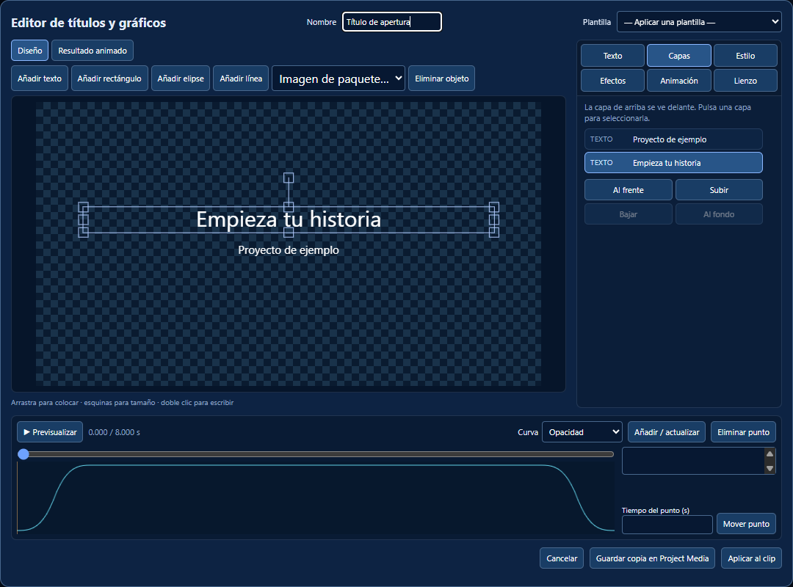

Pestaña Capas: pulsa una capa para seleccionarla y ordénala con los cuatro botones.

### Seleccionar y ordenar

Pulsa una capa para seleccionarla en el lienzo; las demás pestañas muestran sus propiedades. Al frente, Subir, Bajar y Al fondo cambian su orden. Con el lienzo enfocado: Ctrl + ] sube, Ctrl + [ baja, Ctrl + Mayús + ] trae al frente y Ctrl + Mayús + [ envía al fondo.

### Formas e imágenes

Además de texto y rectángulo puedes añadir elipses y líneas; «Sin relleno» deja solo el contorno y el efecto Dibujar el trazo lo traza poco a poco. Imagen de paquete… añade los adornos de los paquetes instalados, que se mueven, escalan, giran y animan como el resto.

### Mismo resultado al exportar

El orden de las capas se guarda en el título, en Project Media y en el proyecto, y es el mismo en la vista previa y en el render.

## Diagramas animados y vídeo vertical

Novedad de la 0.28. El editor de títulos puede trabajar en vertical y dibujar flechas, marcas y contadores que entran paso a paso, sincronizados con lo que se dice.

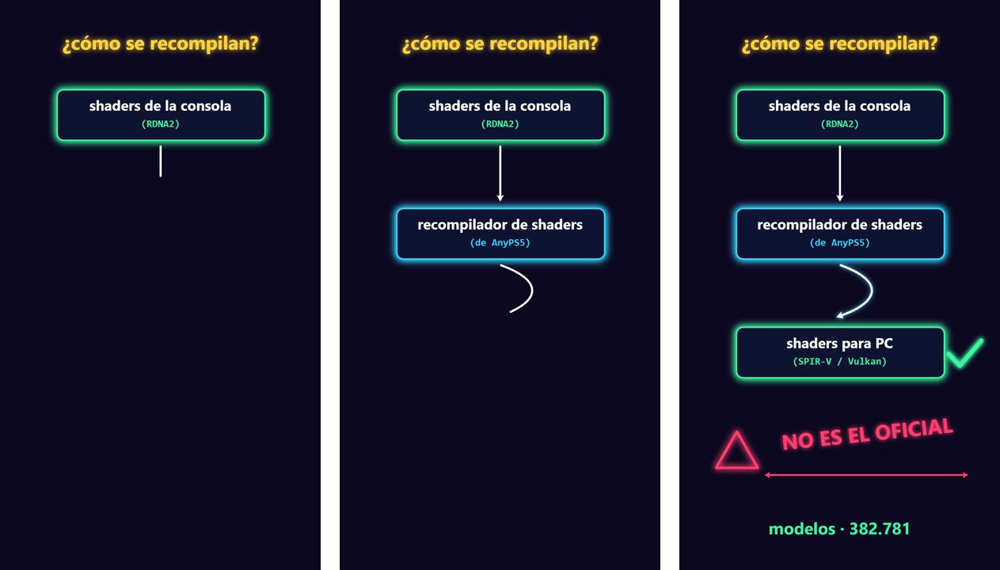

Un diagrama vertical que se construye solo: caja, flecha, caja, flecha curva, marca de visto, aviso y contador.

### Lienzo vertical

Lienzo > Tamaño del lienzo: horizontal 16:9, vertical 9:16 (1080×1920), cuadrado, 4:5 o 4:3. Un título vertical llena un vídeo vertical sin bandas.

### Flechas

Añadir flecha crea una flecha curva que se dibuja sola. Estilo > Punta de flecha la pone en un extremo o en los dos de cualquier línea o trazo.

### Paso a paso

Cada objeto entra con su retraso (Efectos): caja con Escalar, texto con Subir por palabra, flecha con Dibujar el trazo. Los contadores («modelos · 382.781») y los trazos libres los crea un asistente por MCP.

### Montaje automático

Por MCP, un asistente transcribe la voz con tiempos por palabra, coloca cada diagrama cuando se nombra y baja la cámara a la mitad inferior. Ver MCP.md.

## Subtítulos automáticos y edición

Los subtítulos son eventos de una pista propia. Puedes corregir sus textos y tiempos sin recortar los eventos de vídeo o audio.

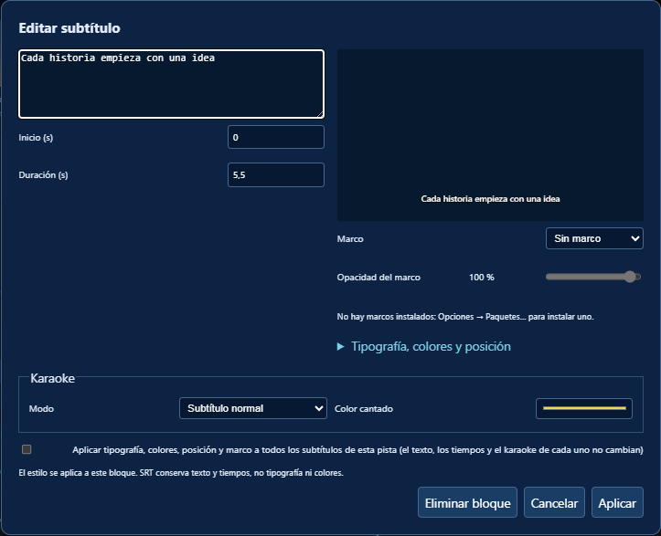

Edición de una frase de ejemplo introducida manualmente, no obtenida por reconocimiento del audio de demostración.

### Generar desde vídeo o audio

Selecciona la fuente con voz y abre la herramienta de subtítulos. Puedes trabajar con el sonido de un vídeo o una pista de audio. Elige idioma y motor, genera y revisa la pista resultante.

### Elegir motor

Faster Whisper INT8 es la opción principal; whisper.cpp se conserva como alternativa para comparar. Los modelos incluidos trabajan sin conexión. Más velocidad no garantiza más acierto: durante música sin voz pueden aparecer textos inventados. Revisa y elimina esas frases.

### Corregir y presentar

Edita cada evento, ajusta su duración y elige fuente, tamaño, color, contorno y posición. Comprueba la legibilidad sobre imágenes claras y oscuras. Si utilizas SRT, recuerda que ese formato conserva texto y tiempos, pero no todos los estilos ni el karaoke.

## Karaoke y sincronización de la letra

El modo karaoke resalta el texto mientras avanza la canción. El botón K de la pista evita activar el efecto frase por frase.

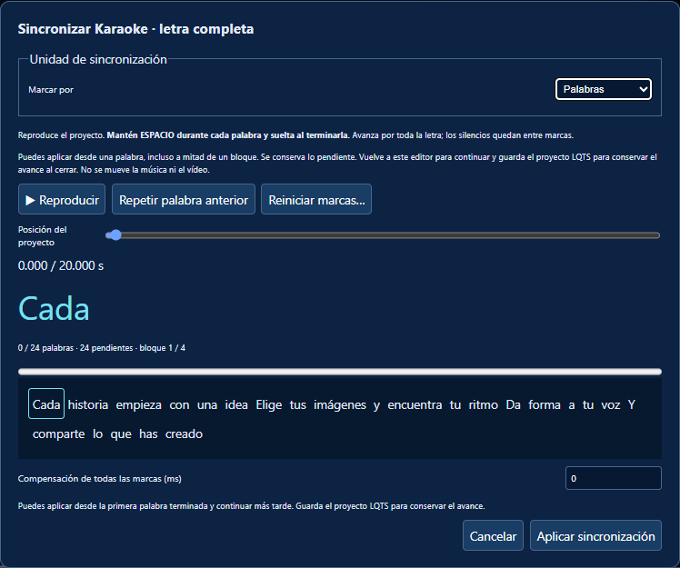

La sincronización de letra completa permite trabajar por palabras o sílabas a lo largo de la pista.

### Activar y abrir el ajuste

Una vez creada y corregida la pista de subtítulos, pulsa K junto a M para activar o desactivar el karaoke de toda la pista. Con botón derecho sobre K abre Sincronizar letra completa…

### Marcar la interpretación

Elige palabras o sílabas. Reproduce y utiliza la barra espaciadora para marcar cada unidad: mantén la pulsación durante su duración y suelta al terminar. Sigue la unidad destacada en la ventana. Corrige el texto antes de sincronizar para evitar rehacer el trabajo.

### Aplicar sin acabar toda la canción

Puedes aplicar una sincronización parcial y continuar después; no es obligatorio marcar toda la letra para conservar lo trabajado. Guarda el LQTS. Reproduce la canción con la pista visible y verifica los enlaces entre frases y las sílabas largas.

## Grabar voz o una toma de audio

Insertar > Grabar audio abre el panel de micrófono. La entrada no se activa hasta que lo solicitas.

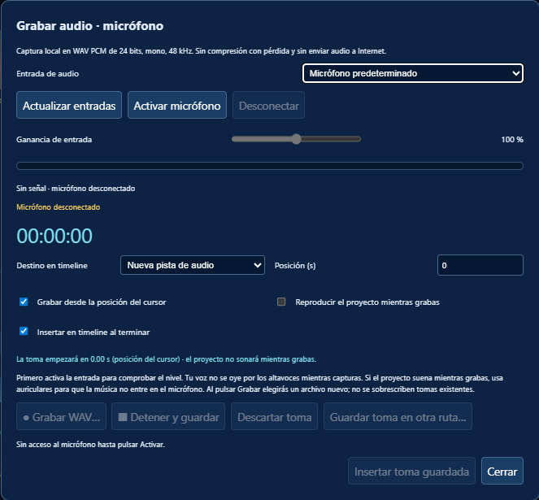

Panel en reposo: esta captura no ha activado ni grabado ningún dispositivo.

### 1. Preparar la entrada

Elige el micrófono y pulsa Activar micrófono. Comprueba el medidor y ajusta la ganancia sin saturar. Usa auriculares si el equipo reproduce sonido que pueda entrar de nuevo por el micrófono.

### 2. Grabar y guardar

Selecciona la pista de destino y la posición, o una pista nueva. Pulsa Grabar WAV… y elige el archivo. Detener y guardar conserva la toma. El formato es WAV PCM de 24 bits, mono, a 48 kHz.

### 3. Incorporar la toma

Si está marcada Insertar en timeline al terminar, aparecerá en el montaje. También puedes insertar una toma ya guardada. Si falla el guardado, utiliza la opción de guardar en otra ruta antes de descartar o cerrar. Desconecta la entrada cuando acabes.

## Grabar cámara y capturar pantalla

Las capturas generan medios para editar después. Haz una prueba corta antes de una grabación larga y comprueba imagen, sonido y espacio libre.

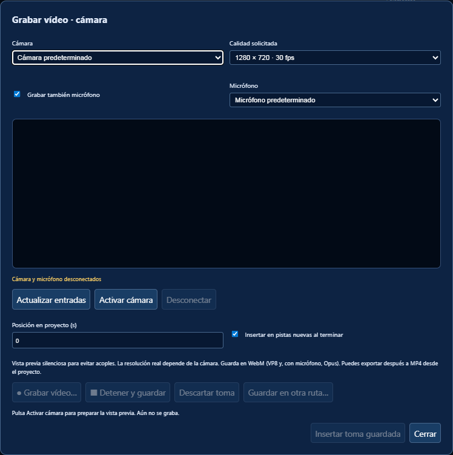

Preparación de cámara, sin activar el dispositivo. La captura de pantalla dispone además de una Toolbox flotante.

### Cámara

Abre Insertar > Grabar vídeo. Elige cámara, resolución y si necesitas audio; activa la entrada para comprobar el encuadre y después graba. Al terminar, guarda la toma y añádela al timeline. La disponibilidad de formatos depende del dispositivo.

### Pantalla y Toolbox

En Insertar > Capturar pantalla selecciona la fuente y las entradas de sonido. La Toolbox flotante permite controlar la grabación, hacer snapshots y mutear micrófono o audio del equipo. Puedes añadir cámara y elegir su posición.

### Cerrar no siempre significa detener

Durante una captura de pantalla, cerrar el panel principal deja la Toolbox y la grabación activas. Finaliza desde sus controles y espera al guardado. La Toolbox está diseñada para quedar fuera de la captura; verifica su exclusión en tu Windows con una toma breve. La cámara superpuesta sí forma parte del resultado si la activas.

## Ver el tramo seleccionado

El intervalo de la regla se ilumina también sobre todas las pistas para mostrar qué parte del montaje estás marcando.

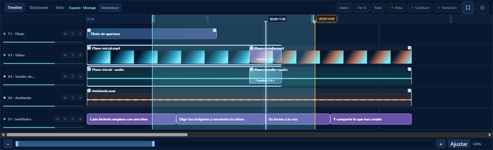

La banda cian comparte los mismos límites de tiempo que la selección superior y deja visibles los medios.

### Marcar y ajustar

Mantén Mayús y arrastra en la regla para marcar el intervalo, o utiliza I y O en la posición del cursor. Arrastra los extremos para ajustarlo. La banda sigue el zoom y el desplazamiento, también en pistas nuevas.

### Continuar editando

El resaltado no selecciona los clips ni bloquea el ratón: puedes moverlos, recortarlos y editar envolventes. Las ondas, los fotogramas y el cabezal siguen visibles. Es una ayuda visual del mismo intervalo usado para renderizar.

### Quitar la selección

Usa Ctrl + Supr, botón derecho sobre el intervalo de la regla > Quitar selección, o el botón Todo. Desaparecen el intervalo y su iluminación; la exportación vuelve a tomar desde el primer clip activo hasta el último. Revisa ese estado antes de renderizar.

## Guardar y renderizar el montaje

Guardar conserva la edición; renderizar crea un archivo audiovisual reproducible. Son operaciones diferentes y conviene hacer ambas.

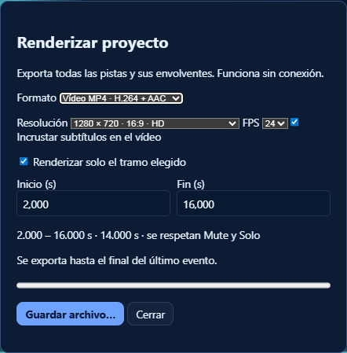

El diálogo de renderizado permite elegir el perfil y los ajustes de salida.

### Guardar la sesión

Ctrl + S guarda el proyecto LQTS; Ctrl + Mayús + S abre Guardar como… Conserva los archivos de medios en sus rutas. Un LQTS no es un paquete que incluya todos los vídeos, sonidos o fuentes del ordenador.

### Seleccionar una parte

Usa Mayús y arrastra en la regla, o fija los extremos con I y O. Una banda cian ilumina el intervalo sobre todas las pistas. Botón derecho > Quitar selección o Ctrl + Supr retira el intervalo y su resaltado. Sin selección se usa desde el primer clip activo hasta el final del último; los huecos interiores se conservan.

### Renderizar y revisar

Elige Archivo > Renderizar o Exportar, revisa el perfil y el destino. Se respetan los estados de silencio y solo. Al finalizar se cierra el panel de render y se muestra el aviso de finalización. Abre el archivo generado y comprueba inicio, final, imagen, texto y mezcla.

## Elegir el archivo de salida

El destino determina el formato. Conserva el LQTS aunque ya hayas exportado: el vídeo final no sustituye a una sesión editable.

### Vídeo para compartir

MP4 ofrece una salida habitual de vídeo con audio. WebM es otra opción disponible. El selector muestra dimensiones y proporción: 16:9 horizontal, 9:16 vertical, 4:5, 1:1 cuadrado, 4:3 y 3:4. Por ejemplo, 1080 × 1920 es Full HD vertical. Puedes elegir 24, 25 o 30 fps. Usa Pan/Crop para ajustar el encuadre; el formato no reencuadra automáticamente los clips. Revisa las opciones del perfil antes de empezar.

### Audio sin imagen

WAV es apropiado para conservar audio PCM; FLAC permite compresión sin pérdida. MP3 y M4A son alternativas comprimidas para distribución. Elige una ruta distinta del archivo fuente para conservar el original.

### Una imagen fija

Sitúa el cursor en el fotograma deseado y usa la exportación de fotograma de Archivo. PNG permite guardar la composición como imagen de alta calidad, con opciones de tamaño, incluida salida 4K cuando se ofrece en ese diálogo.

### GIF animado

Exporta un intervalo breve a GIF si necesitas una animación sin sonido. El formato utiliza una paleta limitada y puede perder calidad en degradados. Una resolución y duración contenidas evitan archivos innecesariamente grandes.

### Ayuda y versión

Ayuda > Manual de usuario abre la guía local más reciente. Ayuda > Acerca de… muestra el nombre, el nuevo símbolo y la versión de la aplicación. Algunas capturas de herramientas conservan la marca de versiones previas; sus controles siguen vigentes.

### Control final

Antes de entregar, revisa que no haya pistas silenciadas por error, intervalos de render olvidados o fuentes ausentes. Guarda una copia del proyecto y conserva sus medios junto a la entrega final.

## Trabajar con proyectos de VEGAS

La compatibilidad con VEGAS es un proceso de intercambio con límites. No se garantiza la apertura fiel de cualquier VEG binario ni la equivalencia de todos sus efectos.

### Abrir con el puente de intercambio

Guarda primero el proyecto en VEGAS. En LQTAC elige Abrir proyecto VEGAS y selecciona el VEG. Si falta un puente vigente y VEGAS está instalado en el equipo, LQTAC intenta iniciarlo y ejecutar la conversión. Resuelve en VEGAS cualquier aviso de medios o licencia. Después revisa el informe y guarda como LQTS.

### Alternativa desde el equipo con VEGAS

Abre el proyecto en VEGAS y ejecuta ExportLqtac.cs, con su .config al lado, desde tools/vegas. Genera un .lqtac-vegas.json junto al VEG. Copia ambos y los medios al otro equipo; allí podrás abrirlo desde LQTAC sin necesitar VEGAS para reutilizar ese puente.

### Si cambia el proyecto original

Vuelve a generar el puente después de modificar el VEG. Debe corresponder al proyecto actual. Lleva también los medios al equipo de destino y conserva sus rutas o restaura las ubicaciones que se indiquen como ausentes.

### Qué necesita revisión

El intercambio contempla pistas, eventos, tiempos, agrupaciones y determinados ajustes y envolventes. Plugins, composiciones y comportamientos específicos de VEGAS pueden quedar sin soporte. Revisa las advertencias; compara un render corto de referencia antes de continuar un trabajo importante.

### Qué es un SFK

Los archivos SFK son cachés de formas de onda de audio de VEGAS. No contienen la configuración completa de ese medio en el montaje ni sustituyen al VEG o al puente de intercambio.

### Un método seguro de migración

Conserva el original. Prueba primero un proyecto pequeño, con medios conocidos, fundidos y una agrupación de vídeo y audio. Comprueba duración, sincronía, niveles y encuadres antes de trasladar una sesión compleja.

## Preferencias, monitor y línea de tiempo

Los menús Ver y Opciones reúnen el aspecto, el monitor, la línea de tiempo y el autoguardado. Las preferencias son de este equipo y no se guardan en el proyecto.

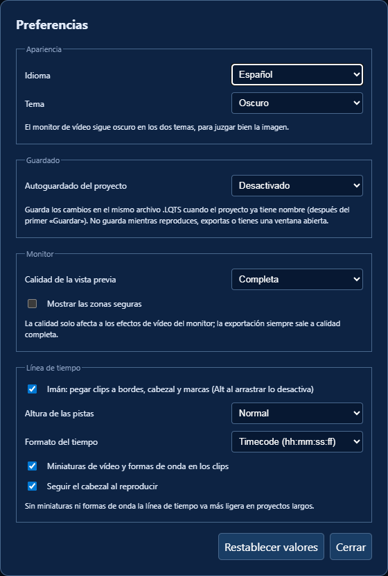

Opciones > Preferencias…, también desde el botón de ajustes de la barra lateral.

### Monitor

Safe Areas muestra las zonas seguras: acción al 90 % y títulos al 80 %. Calidad elige Completa, Media o Borrador para aligerar la vista previa; la exportación siempre usa la calidad completa. El botón de pantalla completa amplía el monitor y Esc vuelve.

### Línea de tiempo

El imán pega los bordes a otros clips, al cabezal y a las marcas de render a menos de 8 píxeles; mantén Alt para soltar libre. En sus ajustes eliges la altura de las pistas, el formato del tiempo, las miniaturas y si la vista sigue al cabezal.

### Autoguardado y estado

El autoguardado (desactivado por defecto) guarda cada 1 a 15 minutos en el mismo LQTS, una vez guardado el proyecto. Encima del monitor verás «Cambios sin guardar» o «Guardado hace…», con un punto naranja si hay cambios pendientes.

## Idioma y tema

Cinema Studio puede mostrarse en otros idiomas y con un tema claro. Ambos cambios son inmediatos y no cierran el proyecto.

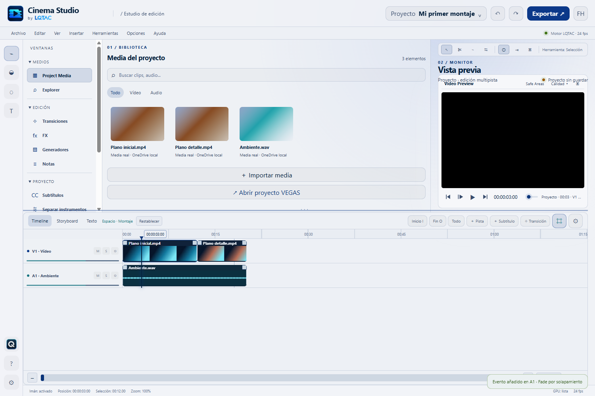

Tema claro: el monitor y los clips conservan sus colores para juzgar bien la imagen.

### Idioma

Opciones > Preferencias > Apariencia > Idioma: español, inglés, francés, chino simplificado o japonés. La etiqueta también dice «Language». Se traducen menús, editores y mensajes; los nombres de clips y pistas, los subtítulos y las notas se quedan como los escribiste. Este manual y los textos para asistentes MCP están en español.

### Tema

Ver > Apariencia u Opciones > Preferencias > Apariencia > Tema: Oscuro (por defecto) o Claro. Se recuerda en este equipo.

## Paquetes de contenido

Los paquetes .lqpack añaden marcos de subtítulos, rótulos, imágenes, máscaras de transición y presets. Solo se instalan los firmados por LQTAC.

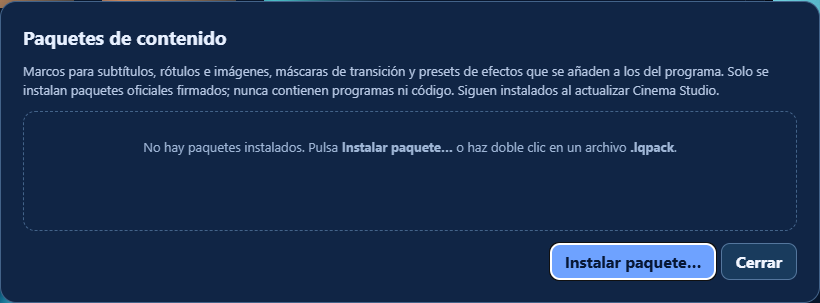

Opciones > Paquetes…: gestor de paquetes instalados.

### Instalar

Abre Paquetes… y pulsa Instalar paquete…, o haz doble clic en un archivo .lqpack. Antes de instalar se muestran el nombre, la versión, la firma y el contenido. Se rechazan los paquetes no oficiales y los modificados después de firmarlos. Un paquete solo contiene imágenes y datos, nunca programas.

### Usar el contenido

Marco en el editor de un subtítulo, o Marco de los subtítulos en las propiedades de la pista para todos; plantillas «· paquete» en el editor de títulos; Imagen de paquete… para adornos; Máscara de un paquete en las transiciones; y el grupo Paquetes en los presets.

### Activar o desinstalar

Activado oculta el paquete sin borrarlo; Desinstalar lo elimina. Un proyecto que use un paquete ausente se abre igual, pero ese marco o imagen no se dibuja hasta que vuelvas a tenerlo.

## Asistente Qbit

Qbit es un asistente opcional que funciona en tu equipo, sin conexión. Entiende peticiones en español sobre el proyecto abierto y propone los cambios antes de hacerlos.

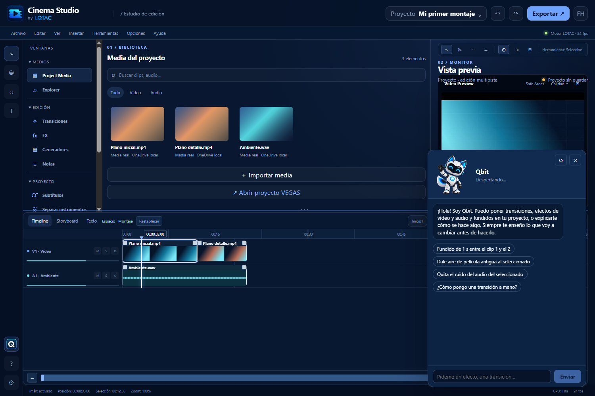

Ayuda > Asistente Qbit… o el botón Q de la barra lateral abren su panel flotante.

### Qué puede hacer

Poner transiciones entre dos clips seguidos, aplicar efectos de vídeo y de audio, fundidos de entrada y salida, quitar efectos y deshacer o rehacer. También contesta de forma breve preguntas de uso. Si falta información, por ejemplo qué clip, la pide.

### Siempre con tu permiso

Qbit enseña «Te propongo:» con la lista exacta de cambios y nada cambia hasta pulsar Aplicar. Ctrl + Z lo deshace como cualquier otro cambio.

### Instalación y tiempos

No viene en el ZIP: la primera vez el panel ofrece descargarlo (unos 2 GB, comprobados por partes). Se instala junto al programa. En un portátil sin gráfica dedicada tarda alrededor de un minuto en despertar y unos 6–10 s por respuesta.

## Control desde un asistente de IA (MCP)

Opciones > Control MCP local permite que un asistente compatible, como Claude o Codex, monte y exporte tus proyectos en este equipo.

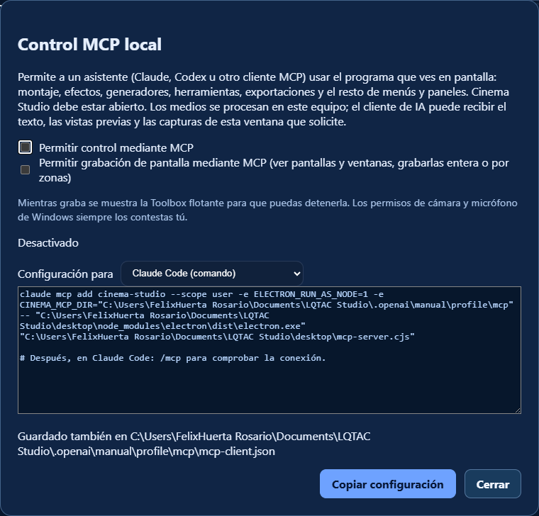

Control MCP local: activar el acceso y copiar la configuración para cada asistente.

### Activar y conectar

Activa el control, elige tu asistente y pulsa Copiar configuración (Claude Code, Claude Desktop, Codex u otros). El asistente trabaja sobre el montaje visible: importa, edita, aplica efectos, crea trayectorias, transcribe y renderiza. Los medios no salen del equipo, aunque el asistente puede enviar a su proveedor los textos y vistas previas que pida.

### Grabación con permiso

Permitir grabación de pantalla mediante MCP está desactivado por defecto. Solo con él activado el asistente puede grabar una pantalla, una ventana o una zona. Los permisos de cámara y micrófono de Windows los contestas siempre tú.

### Grabar una zona sin MCP

En Grabar pantalla, elige la fuente, pulsa Preparar captura y después Seleccionar zona…: arrastra sobre la imagen para dibujar la zona que quieres grabar.

## Atajos de uso frecuente

Estos atajos corresponden a la edición principal. Dentro de un campo de texto o un editor específico, las teclas pueden actuar sobre ese control.

| Atajo | Acción |
| --- | --- |
| Ctrl + N | Nuevo proyecto |
| Ctrl + O | Abrir proyecto |
| Ctrl + S | Guardar proyecto |
| Ctrl + Mayús + S | Guardar como… |
| Ctrl + C / Ctrl + V | Copiar / pegar eventos seleccionados |
| Ctrl + Z / Ctrl + Y | Deshacer / rehacer |
| S | Dividir los eventos seleccionados en el cursor |
| Supr | Eliminar la selección |
| ← / → | Mover el cursor un fotograma |
| Mayús + ← / → | Mover el cursor un segundo |
| I / O | Fijar inicio / final del intervalo de render |
| Ctrl + Supr | Quitar el intervalo de render |
| Ctrl + arrastrar borde | Cambiar velocidad del conjunto |
| Ctrl + Alt + arrastrar borde | Cambiar velocidad de un solo clip |
| Mayús al mover PAN | Restringir la cámara a un eje |

### Dos controles que se parecen

La tecla S divide; el botón S de la pista activa Solo. Supr borra eventos; Ctrl + Supr quita el intervalo de render. Antes de usar un atajo comprueba qué área tiene el foco.

## Resolver dudas habituales

Empieza por una comprobación breve y reversible. Guarda el proyecto antes de reorganizar carpetas o probar cambios importantes.

### El programa no encuentra el motor

Asegúrate de haber extraído el portable completo. No abras el ejecutable desde el interior del ZIP ni copies solo el lanzador. Comprueba que las carpetas incluidas siguen a su lado y que Windows o el antivirus no han retirado un componente.

### No se ve o no se oye lo esperado

Sitúa el cursor sobre un evento, revisa su pista y comprueba Mute y Solo. Mira también el volumen del sistema y el dispositivo de salida. La previsualización principal sigue las pistas del proyecto, no el último elemento que hayas elegido en la biblioteca.

### El proyecto abre con medios ausentes

El LQTS guarda referencias. Devuelve los archivos a las rutas indicadas. Evita renombrar o mover medios durante el montaje. Al llevar el trabajo a otro ordenador, copia los medios y las fuentes además del proyecto.

### La reproducción va a saltos

Reduce los efectos simultáneos, cierra otros procesos y comprueba que los medios estén en almacenamiento local disponible. La previsualización puede ser más exigente con varios vídeos, PAN y efectos animados. Evalúa también un render corto antes de atribuir el problema al archivo final.

### Un texto automático no corresponde al audio

El reconocimiento puede inventar frases en música o silencio. Corrige la pista manualmente o compara el otro motor. La transcripción siempre necesita revisión, especialmente para letras cantadas.

### Antes de darlo por terminado

Guarda, revisa el intervalo y los estados M/S, renderiza una muestra, escucha con auriculares y vuelve a abrir el proyecto. Conserva una copia de seguridad independiente del portable y de los medios.
