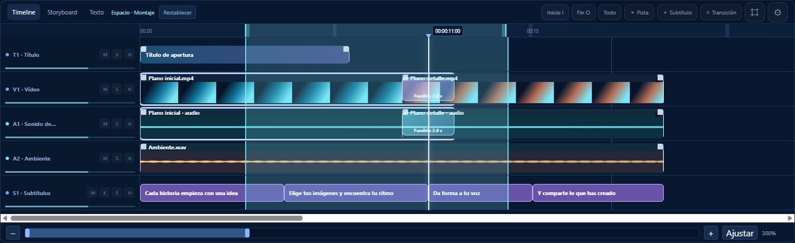

# Ver el intervalo seleccionado sobre las pistas

Al marcar una parte de la canción o del montaje en la regla, una banda cian ilumina ese mismo intervalo sobre todas las pistas. Los límites verticales indican exactamente su principio y final. Las ondas y los fotogramas siguen visibles.

La banda sigue el zoom, el desplazamiento y los cambios de inicio/fin. También aparece sobre pistas nuevas. No bloquea el ratón: puedes seguir seleccionando, moviendo o recortando los clips y editando envolventes.

Para retirar el intervalo y la iluminación, usa **Ctrl + Supr**, **botón derecho sobre el intervalo de la regla → Quitar selección**, o el botón **Todo** del timeline.

Es el mismo intervalo usado para renderizar una parte del proyecto. El resaltado es una ayuda visual; no altera el audio, el vídeo ni la selección individual de clips.

